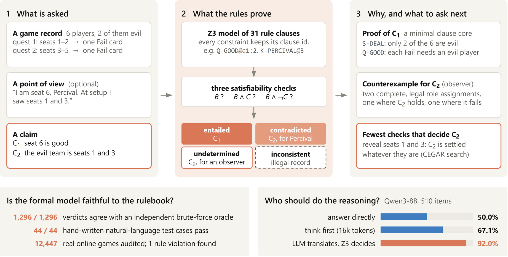

# 阿瓦隆：用约束求解验证身份推理，以及最少需要查验谁

课程：程序设计（约束求解）大作业。材料是《The Resistance: Avalon》官方规则书。

项目内容：把规则书形式化为约束，然后用求解器判断关于身份的说法在给定对局记录和视角下的地位，分为必然成立、必然不成立、无法确定、记录违反规则四类。在无法确定时，求解器还会给出最少需要用湖中仙女查验哪几位玩家。真实数据来自 avalonlogs 的约 1.2 万局真人对局；LLM 对照实验使用 Qwen3-8B。

## 目录

| 路径 | 内容 |
|---|---|
| `RULES.md` | 条款覆盖表：规则 → 约束 → 测试；编码变体；未形式化的内容 |
| `avalon/game.py` | 角色、人数表、记录格式、中文渲染 |
| `avalon/smt.py` | Z3 编码：按条款编号跟踪约束；给出正反见证、最小冲突条款、两世界检验 |
| `avalon/oracle.py` | 独立穷举实现：表格重新录入，任务规则用另一种写法，只用于交叉验证 |
| `avalon/search.py` | 最少揭示集合：朴素枚举、反例引导的最小命中集（CEGAR）、自适应极小极大 |
| `avalon/cases.py` | 44 个手写自然语言测试，覆盖简单、边界、组合、视角、矛盾、编码变体 |
| `avalon/selfcheck.py` | 验收：手写用例、随机对局正确性、Z3 与穷举一致性、篡改记录检测、最少集合、投票不携带信息 |
| `avalon/sim.py` | 随机生成合法对局 |
| `avalon/logs.py` | avalonlogs 解析与规则审计；投票字段含义和座位方向由数据判定 |
| `avalon/analyze.py` | 真实对局分析：可推出性、编码变体影响、刺杀、最少查验 |
| `avalon/llm_tasks.py` | 冻结 LLM 评测集（510 题，四类标签分层） |
| `avalon/llm_run.py` | 提示词、Qwen3-8B 运行器、评分 |
| `avalon/build_colab.py` | 生成自包含的 `colab_avalon.ipynb` |
| `avalon/followup.py` | 后续实验：thinking 预算续写与强制作答、不读标准答案的验证流水线、抽取修复、评分 |
| `avalon/build_followup_colab.py` | 生成 `colab_avalon_followup.ipynb` 与输入包 `avalon_followup_inputs.zip` |
| `CODEX_FOLLOWUP.md` | 后续实验执行说明 |
| `tests/fixture_avalonlogs/` | 按真实日志结构构造的解析测试样例 |
| `CODEX_HANDOFF.md` | 实验执行说明 |
| `report/` | 课程论文、PDF、可编辑主图与图表生成脚本 |
| `results/` | 冻结题集、逐题输出、审计与评分结果 |

## 已完成的结果

论文：[PDF](report/main.pdf) · [LaTeX 源码](report/main.tex)。执行记录：[首次实验](RUN_REPORT.md) · [后续实验](FOLLOWUP_RUN_REPORT.md)。

510道冻结题，Qwen3-8B单次既定采样：

| 条件 | 准确率 |
|---|---:|
| 直接回答 | 50.00% |
| Thinking，16384预算（严格解析） | 67.06% |
| 模型抽取 + Z3直接决策 | 91.96% |
| 真实证据反馈后由模型修正 | 89.22% |

首次96.86%的证据纠错条件使用正确形式化并依据标准答案挑选错误题，是受控上限实验；后续89.22%条件由模型自己的抽取触发验证。两者评测范围不同。抽取修复触发85次，未改变形式化结果。详细指标、配对置信区间和限制见报告。



## 本地验收与评分

Python 3.12（本地验收）或原Colab的Python 3.13；先建立自己的虚拟环境：

```powershell
python -m venv .venv
.venv\Scripts\python.exe -m pip install -r requirements.txt
$env:PYTHONIOENCODING = "utf-8"
.venv\Scripts\python.exe avalon\selfcheck.py --quick --out results\selfcheck_reproduction
.venv\Scripts\python.exe avalon\followup.py --selftest
.venv\Scripts\python.exe avalon\followup.py --score --new results\followup_run\results_followup\llm --out results\metrics_followup_reproduction.json
```

Linux/macOS将解释器路径替换为`.venv/bin/python`。完整编码验收可去掉`--quick`。已有结果无需GPU即可重新评分。逐题文件与冻结输入按原始字节跟踪，避免换行转换破坏SHA256。

## Colab实验

- 首次实验：[colab_avalon.ipynb](colab_avalon.ipynb)。真实日志在Colab内克隆，含冒号的原始文件名不兼容Windows。
- 后续实验：[colab_avalon_followup.ipynb](colab_avalon_followup.ipynb)。使用已提交的`avalon_followup_inputs.zip`，复用冻结题集及首次输出；显存至少40GiB且支持BF16。
- 严格步骤见[首次执行说明](CODEX_HANDOFF.md)及[后续执行说明](CODEX_FOLLOWUP.md)。首次说明中的A100要求后经授权放宽，实际运行使用95GiB RTX PRO 6000；详见运行报告。
- 不需要重新生成已有notebook。生成器仅供维护；后续输入包的SHA256必须与notebook一致。

## 论文与图表

论文PDF及图表已提交，可直接阅读。重编译需要TeX Live（XeLaTeX、BibTeX、LNCS与中文支持）：

```powershell
cd report
.\build.ps1
```

图表重生成依赖matplotlib和Z3，可从仓库根目录运行`python report/figures/make_figures.py`；测试用例表用`python report/tables/make_tables.py`生成。主图的`.drawio`与`.tex`源文件均保留。字体在不同系统上可能有所差异。论文作者及学号当前为占位符，提交课程前填写。

## 数据与仓库范围

保留本项目代码、论文、冻结题集、逐题模型输出、评分和审计材料。输入数据来源及固定commit见运行报告与论文参考文献。原始avalonlogs仓库、模型权重、虚拟环境、缓存、重复下载ZIP和本地浏览器截图不纳入Git。旧航空项目仅留在本地`_archive_tau2/`，没有修改或删除。
